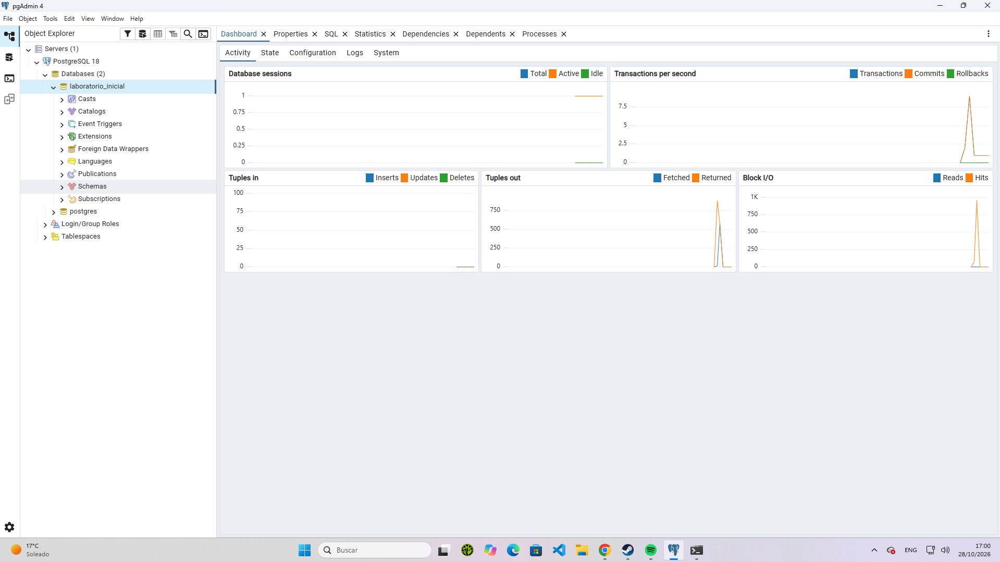
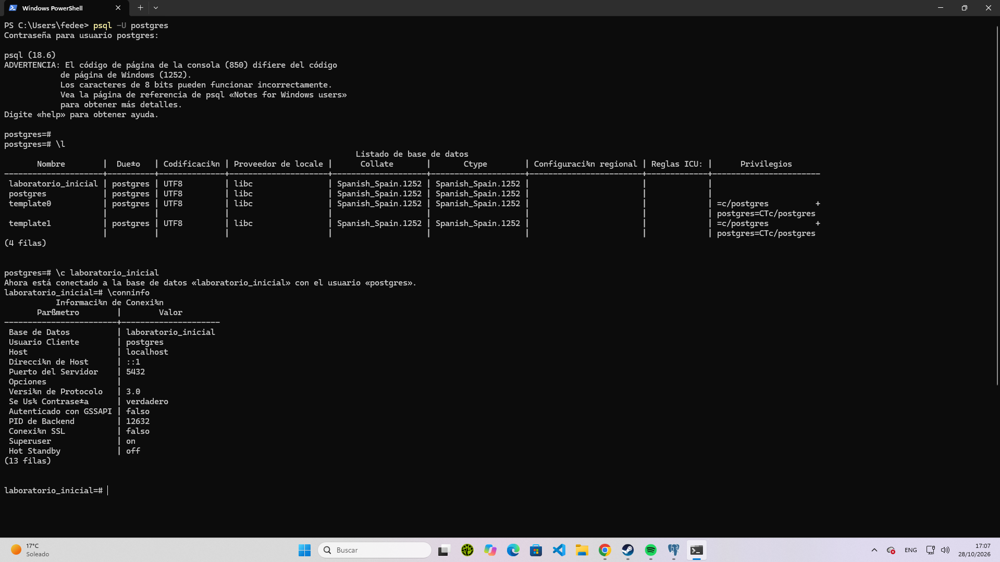

# Práctica: Verificación del Ecosistema PostgreSQL y Modelo Cliente-Servidor

Este documento recopila la evidencia técnica y la documentación requerida para la preentrega de PostgreSQL, validando el funcionamiento del servidor local y el uso tanto de la interfaz gráfica como de la línea de comandos.

---

## 1. Verificación del Servidor Local
* **Objetivo:** Confirmar que el servicio del motor de base de datos PostgreSQL se encuentra activo en la máquina local para permitir conexiones[cite: 9].
* **Procedimiento:** Se verificó mediante los Servicios de Windows (`services.msc`), comprobando que el servicio correspondiente a la versión instalada (`postgresql-x64-18`) se encuentre en estado **En ejecución (Running)**.

---

## 2. Conexión vía pgAdmin 4 (GUI)
* **Objetivo:** Establecer una conexión mediante la interfaz gráfica y crear la base de datos de prueba solicitada[cite: 9].
* **Procedimiento:** 
  1. Se abrió pgAdmin 4 y se autenticó en el servidor local de PostgreSQL 18[cite: 9].
  2. Se creó la base de datos requerida con el nombre exacto: `laboratorio_inicial`[cite: 9].
* **Evidencia:**
  

---

## 3. Conexión vía psql (CLI)
* **Objetivo:** Conectarse al servidor utilizando la interfaz de línea de comandos (`psql`) y validar los parámetros de conexión[cite: 9].
* **Procedimiento:**
  1. Se configuraron previamente las variables de entorno de Windows para acceder a `psql` directamente desde la terminal.
  2. Se ejecutó el comando de conexión especificando el usuario y la base de datos:
     ```powershell
     psql -U postgres -d laboratorio_inicial
     ```
  3. Dentro de la sesión, se ejecutó el comando de control para mostrar los detalles de la conexión actual:
     ```sql
     \conninfo
     ```
* **Evidencia:**
  

---

## 4. Conclusiones y Diferencias Operativas
Tras interactuar con ambos clientes, se identifican las siguientes diferencias clave en el modelo cliente-servidor:
* **Interfaz Gráfica (pgAdmin 4):** Ofrece un entorno visual sumamente intuitivo, ideal para la administración de esquemas, visualización de estadísticas de rendimiento en tiempo real a través de su *Dashboard* y gestión general del servidor sin requerir sintaxis compleja de comandos.
* **Interfaz de Línea de Comandos (psql):** Proporciona una vía ligera, rápida y directa para interactuar con el motor de base de datos. Es indispensable para la automatización, scripts de migración y diagnósticos rápidos mediante metacomandos (`\l`, `\conninfo`, `\c`, etc.).